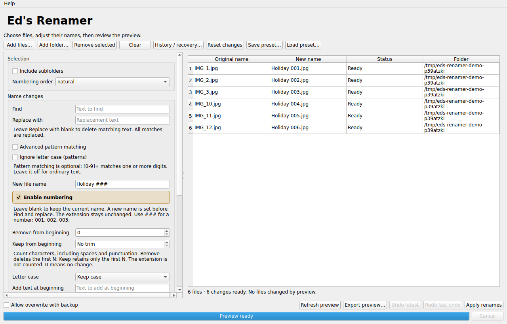

# Ed's Renamer 1.1.0

A Linux desktop app for bulk renaming music, photos, comics and other files.
Adjust the names, review a live preview, then apply the changes. The approved
blue document icon with three `#` symbols represents its numbering feature.



## Download and run an AppImage — start here

### 1. Download the application

Open [the latest release](https://github.com/edjenn1998/eds-renamer/releases/latest),
expand **Assets**, and download **`EdsRenamer-1.1.0-x86_64.AppImage`**.
The “Source code” ZIP/tar downloads are for developers, not the ready-to-run app.

The AppImage includes Python, Qt, the icon and the application dependencies. It
targets **64-bit Intel/AMD Linux with glibc 2.35 or newer**, such as Ubuntu 22.04
and newer, on a graphical desktop. It is not a Windows/macOS executable or an
ARM/Raspberry Pi or Alpine/musl build. The release includes its actual ABI audit.

### 2. Allow the file to run

An AppImage is a portable application file, **not an installer or ZIP archive**.
Keep it in Downloads, or move it somewhere permanent, such as an `Applications`
folder in your home directory.

On Ubuntu and many other Linux desktops:

1. Right-click the AppImage and choose **Properties**.
2. Open **Permissions** and enable **Allow executing file as program**. Other
   file managers may call this **Executable as Program**.
3. Close Properties and double-click it. Choose **Run** if prompted.

You do **not** need Python, administrator access or `sudo` to run the app. The
first launch may take a moment. For an optional menu shortcut, choose
**Help > Add to application menu**. The shortcut points to the downloaded
AppImage; keep that file in place and reinstall the shortcut after moving or
replacing it with a differently named version.

### Terminal alternative

Open a terminal in the download folder (in Ubuntu Files, right-click the folder
background and select **Open in Terminal**):

```sh
chmod +x ./EdsRenamer-1.1.0-x86_64.AppImage
./EdsRenamer-1.1.0-x86_64.AppImage
```

Use the actual filename you downloaded. `./` means “run this file in the current
folder.” If you see “No such file,” check the filename and the terminal's folder.

### If launching fails: no-FUSE mode

This release uses a modern, statically linked AppImage runtime: **the older
`libfuse2`/`libfuse2t64` package is not required**. Normal launching still uses the
kernel's FUSE mount facility. If your computer restricts mounting, or you see a
FUSE or permission error, use the built-in no-FUSE launch mode:

```sh
./EdsRenamer-1.1.0-x86_64.AppImage --appimage-extract-and-run
```

It extracts the app to a temporary folder, runs it and cleans up after exit. No
FUSE package installation or administrator access is needed; allow enough free
temporary space. If the download's filesystem prohibits executing files, move
the AppImage into your home directory first.

For an extracted copy you can keep:

```sh
./EdsRenamer-1.1.0-x86_64.AppImage --appimage-extract
./squashfs-root/AppRun
```

An error mentioning a newer `GLIBC` version means the distribution is too old
for this build; installing FUSE will not fix it. For other startup problems,
launch from a terminal and include the error text and your Linux version in a
[GitHub issue](https://github.com/edjenn1998/eds-renamer/issues).

### Updates, removal and optional checksums

Updates are manual: download the new AppImage, make it executable and use it in
place of the old file. Deleting an AppImage removes the application file, **not
your renamed files or history**. Remove a manually extracted `squashfs-root`
folder too if you no longer need it.

History remains in **`~/.renamer/sessions/`** for compatibility. Hidden overwrite
backups stay beside the affected files so undo can restore them. Keep the history
and backups if you want recovery/undo; updating the app does not delete them.
Window geometry is stored in `~/.config/edjenn1998/EdsRenamer.conf` on Linux.

Optional: download `SHA256SUMS` beside the release files and verify integrity:

```sh
sha256sum --ignore-missing --check SHA256SUMS
```

The AppImage should report **OK**. This checks download integrity, not publisher identity.

## Using Ed's Renamer

1. **Add files…**, **Add folder…**, or drag files/folders into the window.
2. Adjust the operations you need. Other controls can stay at their defaults.
3. Review the **Original name / New name / Status / Folder** table. It updates
   after a short typing pause, without changing the selected files.
4. Resolve any blocked names or collisions. **Export preview…** saves the current
   table as CSV, including blocked results, for review outside the app.
5. Click **Apply renames** and confirm the reviewed batch. Source and destination
   identities are checked again; changed files require a fresh preview.

**Refresh preview** rescans selected folders, refreshing file ordering and the
reviewed state. Existing rows remain visible during edits. **Reset changes**
restores default operations without clearing the file selection.

### Operations and numbering

- **New file name:** leave blank to retain the name. A supplied name replaces
  the original stem before Find and replace. The extension is preserved.
- **Find / Replace with:** replace every literal match in the stem. Leave
  Replace with empty to delete matching text.
- **Advanced pattern matching:** optional regular expressions; `[0-9]+` matches
  digits. Pattern/replacement text is limited to 4096 characters. Matching has a
  50 ms timeout per filename; overly expensive patterns fail inline instead of
  hanging the application. **Ignore letter case (patterns)** applies to this mode.
- **Remove from beginning:** remove the first N characters and keep the rest.
- **Keep from beginning:** keep the first N characters and remove the rest.
  Spaces and punctuation count; the extension is excluded. In the GUI, zero means
  no change. Remove runs before Keep. Counting uses Unicode code points.
- **Letter case:** change the retained stem's capitalization.
- **Add text at beginning / end:** add text around the retained stem. Include
  a space if you want a gap. End text goes before the extension.
- **Enable numbering** is on by default, in placeholder-only mode. `###` becomes
  `001`, `002`, `003`; `##` becomes `01`, `02`, `03`. Only the first `#` run is
  replaced. Its location and length decide the number position and padding.
  Disable numbering to preserve literal `#` characters in existing comic names.
- **When there is no ###:** choose beginning or end to add numbers to ordinary
  stems, and set the number of digits. Placeholder-only mode leaves stems without
  `#` unchanged.
- **Numbering order:** `name` keeps alphabetical ordering; **`natural`** sorts
  `page2` before `page10`. Modification time, size and random ordering are also
  available. Random order stays stable while editing; Refresh reshuffles it.
- **Extension:** keep it, change case, set it or remove it. Changing `.jpg` to
  another suffix **does not convert the file contents**.

### Presets, undo and recovery

**Save preset… / Load preset…** reuse rename settings as JSON. Presets contain no
file paths or history and never enable overwrite-with-backup. Loading only updates
the preview; it does not rename files.

**Undo latest** reverses the newest completed session. For compatibility, using
Undo latest again reverses that undo (redo). The dedicated **Redo last undo**
button makes this clearer. **History / recovery…** lets you choose a completed
session to reverse or an interrupted session to restore. Its **View journal…**
button is read-only.

**Cancel** stops discovery/planning or requests a transaction-safe stop. Cancelling
an apply or undo rolls back its partial changes; rollback may take time. Cancelling
recovery pauses it with its journal intact, so it can be resumed. Closing waits
for a running transaction to finish; it cancels a read-only preview before closing.

## File protection and limits

The engine validates GUI, CLI and direct API batches. Duplicate or aliased
sources/destinations, missing files/parents, invalid or overlong names, real
directory renames, special files and journal-storage renames are blocked.
Symlinks are renamed as entries, not followed to rename their targets. Folder
discovery excludes journal-managed `.renamer-*` files and the configured history
directory; it does not descend through symlinks.

Linux `renameat2(RENAME_NOREPLACE)` prevents overwriting at the syscall boundary.
Unsupported platforms/filesystems fail rather than falling back to destructive
rename. Swaps/cycles use hidden temporary names. Opt-in **Allow overwrite with
backup** moves existing destination **files** to journaled hidden backups; it
cannot replace directories or special files. Undo restores the prior files.

A complete move plan and identities are saved before the first move. Every
syscall has a pending record; errors trigger rollback. Recovery reconciles an
interruption before/after a move or during rollback, stopping on conflicts or
changed files instead of guessing. Unreadable/damaged journals stay visible in
History and block new changes until repaired/restored; they are not silently
ignored or deleted. Legacy journals remain readable but automatic undo is refused
without the identities needed to verify them.

This is a recoverable sequence, not a filesystem-wide atomic batch. Files may be
visible under temporary names while it runs. Fingerprints use device, inode, mode,
size and nanosecond modification time, **not content hashes**. Avoid concurrent
changes to the batch. Same-size content changes with unchanged recorded metadata
(including writes within a filesystem's timestamp resolution) may not be detected.
A final check/syscall race remains. Locks coordinate only
the same state root, cross-filesystem moves are refused, and network durability
depends on the server. Durable per-move journal writes can make very large batches
slow. This app is a renamer, not a replacement for ordinary backups.

## Command-line use

The AppImage also exposes the existing CLI without requiring a Python install:

```sh
./EdsRenamer-1.1.0-x86_64.AppImage --cli rename photos/ --name 'Photo ###' --number --order natural
./EdsRenamer-1.1.0-x86_64.AppImage --cli rename photos/ --name 'Photo ###' --number --order natural --apply
./EdsRenamer-1.1.0-x86_64.AppImage --cli sessions
./EdsRenamer-1.1.0-x86_64.AppImage --cli undo -y
./EdsRenamer-1.1.0-x86_64.AppImage --cli recover --session SESSION_ID
```

Add `--appimage-extract-and-run` before `--cli` for no-FUSE launching. With source,
use `python rename.py` in place of the AppImage's `--cli` prefix. CLI rename is a
dry run unless `--apply` is supplied. Put `--home STATE_DIR` before the subcommand
to override history storage. CLI Ctrl+C reports recovery guidance and exits 130;
an interrupted transaction can be recovered using its saved session ID.

## Source, tests and builds

Use **Python 3.12** for development/release builds; pinned Qt does not support
Python 3.14. On Ubuntu, venv setup may require `python3.12-venv`. Ubuntu 22.04 does
not ship Python 3.12 by default; the AppImage is the simplest way to run there.

```sh
python3.12 -m venv .venv
. .venv/bin/activate
python -m pip install -r requirements-dev.txt
python renamer_gui.py
QT_QPA_PLATFORM=offscreen python -m pytest tests -q
QT_QPA_PLATFORM=offscreen python renamer_gui.py --self-test
```

Source operation requires the usual Qt display/OpenGL libraries, including
`libegl1`, `libgl1`, `libxcb-cursor0` and `libxkbcommon-x11-0` on Ubuntu.
There are **145 regression tests**, including journal recovery, preview identity
checks, cancellation/rollback, presets, CSV export and real desktop-entry parsing.
The bundled `--self-test` uses disposable files for live previews, regex, numbering
and rename/undo/redo. It does not modify your history.

See [APPIMAGE.md](APPIMAGE.md) for pinned builds and release checks,
[AUDIT.md](AUDIT.md) for the review findings, and [CHANGELOG.md](CHANGELOG.md) for
changes. Current notices and dependency inventories are included in each release;
see [NOTICE.md](NOTICE.md) and [LICENSE](LICENSE). GitHub Actions tests and builds
the AppImage on Ubuntu 22.04. Generated binaries are release assets, not Git files.
